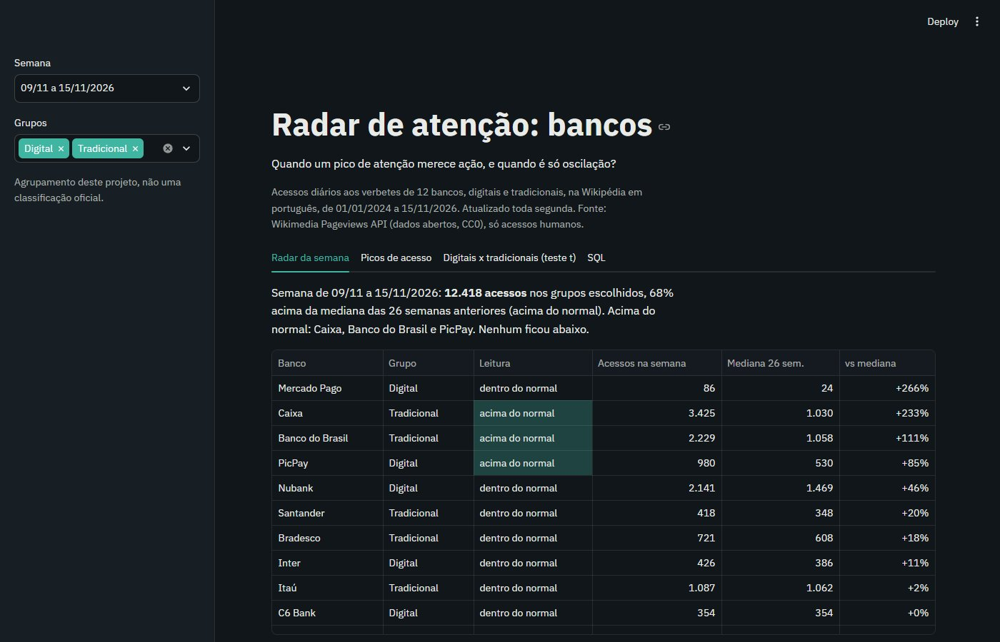
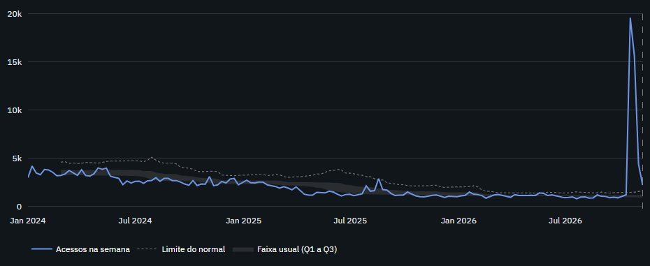
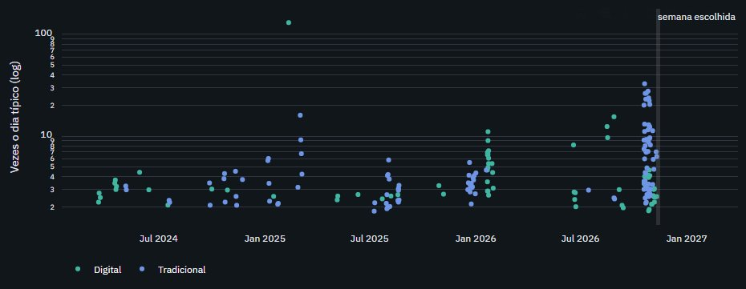
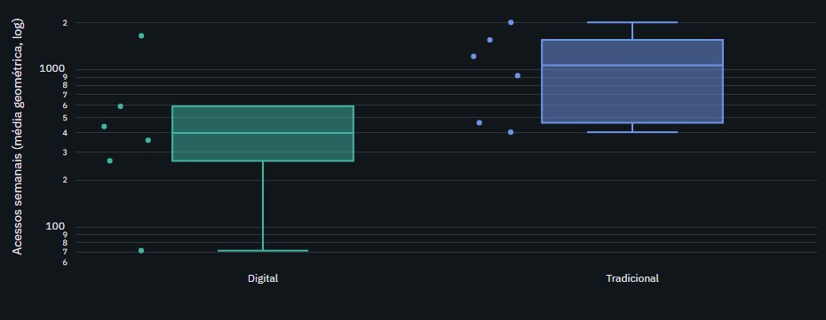

# Radar de atenção: bancos

Projeto de portfólio que monitora a atenção a 12 bancos, 6 digitais e 6 tradicionais, pelos acessos aos verbetes deles na Wikipédia em português. Mostra o ciclo completo de uma análise: coleta por API, banco SQLite consultado em SQL, análise estatística em Python e painel publicado em Streamlit.

**App no ar:** https://radar-atencao-bancos.streamlit.app



## Problema

Quem acompanha indicadores toda semana enfrenta a mesma dúvida: **quando um pico merece ação, e quando é só oscilação?** Os acessos a um verbete sobem e descem o tempo todo. Uma notícia faz o número saltar por um dia e voltar; outras vezes a atenção muda de patamar e fica lá. Olhar o gráfico não basta para separar uma coisa da outra.

O projeto responde três perguntas com critério estatístico explícito:

1. **A semana de um banco saiu do padrão dele?** Cada semana é comparada com as 26 anteriores do próprio banco.
2. **Em que dias os acessos saltaram?** O painel lista os dias atípicos. Um dia atípico que não tira a semana da faixa costuma ser oscilação; uma semana inteira fora do normal indica mudança de patamar.
3. **Bancos digitais têm mais acessos que os tradicionais, ou a diferença cabe no acaso?** Um teste de hipótese responde, com o tamanho da amostra à vista.

## Dados

- **Fonte:** [Wikimedia Pageviews API](https://doc.wikimedia.org/generated-data-platform/aqs/analytics-api/), dados abertos sob licença CC0, sem chave de acesso.
- **Recorte:** acessos diários a 12 verbetes da Wikipédia em português, de 01/01/2024 até o último domingo antes da coleta. Só acessos humanos (`agent=user`); robôs ficam de fora.
- **Bancos e grupos:** 6 digitais (Nubank, Inter, C6 Bank, PicPay, PagBank, Mercado Pago) e 6 tradicionais (Itaú, Bradesco, Banco do Brasil, Caixa, Santander, Safra), listados em [`bancos.csv`](bancos.csv). O agrupamento é deste projeto, não uma classificação oficial.
- **Limite:** o dado conta quantas vezes cada verbete foi aberto. Mede curiosidade, não clientes, participação de mercado nem satisfação. O projeto não compara a qualidade dos bancos.

## Método

| Etapa | Arquivo | O que faz |
|---|---|---|
| Coleta | [`coleta.py`](coleta.py) | Chama a API para cada banco, respeita o limite de taxa (espera e tenta de novo) e grava no SQLite. Rodar de novo substitui as linhas, sem duplicar, e quem sai de `bancos.csv` sai do banco de dados. Tudo numa transação só. |
| Banco de dados | [`schema.sql`](schema.sql) | Duas tabelas: `bancos` e `pageviews` (chave artigo + data). |
| Consulta | [`analise.py`](analise.py) | A agregação semanal sai de SQL (semana de segunda a domingo). O app tem uma aba para rodar consultas próprias, com o banco aberto só para leitura. |
| Faixa de normalidade | `faixa_normal()` | Mediana e intervalo interquartil (IQR) das 26 semanas anteriores. Acima de Q3 + 1,5 × IQR é "acima do normal", o critério do boxplot. Com menos de 8 semanas de histórico, não julga. |
| Picos | `picos()` | z-score robusto em escala log: mediana e MAD dos 90 dias anteriores, corte em 3,5. Mediana e MAD não se deixam distorcer por um único dia de pico, como aconteceria com média e desvio padrão. |
| Digitais x tradicionais | `welch()` | Teste t de Welch sobre a média do log dos acessos semanais **por banco**. Cada banco é uma observação, para não contar 12 semanas do mesmo banco como 12 casos independentes. Welch porque não supõe variâncias iguais. Mostra p-valor, tamanho do efeito (d de Cohen) e n. |
| Atualização | [`coleta.yml`](.github/workflows/coleta.yml) | Toda segunda às 6h (Brasília), o GitHub Actions coleta a semana que fechou no domingo, roda os testes e só então grava o banco. O Streamlit Cloud republica o app a cada gravação. |
| Testes | [`tests/`](tests) | `pytest` com dados sintéticos: a faixa classifica certo, o pico plantado é achado, o teste respeita a amostra mínima, toda semana do SQL começa na segunda, e o app abre sem erro com um grupo ou com os dois. |

## Resultado

Leituras da coleta de 19/11/2026, com dados até 15/11/2026. O painel recalcula tudo toda segunda, e os números abaixo ficam como registro dessa data.

- **Mudança de patamar:** o Banco do Brasil ficou acima do normal por quatro semanas seguidas, a partir de 19/10/2026. Naquela semana, somou 19.579 acessos, contra uma mediana de 1.058; o dia mais alto foi 20/10, com 4.711 acessos, 33 vezes um dia típico. A alta se concentrou nos dias úteis e caiu nos fins de semana. Não foi um dia isolado, e é esse o sinal que, num monitoramento de verdade, pediria investigação. O método aponta *quando*; o *porquê* sai da checagem em notícias.
- **Oscilação:** na semana de 09/11/2026, o Mercado Pago ficou 266% acima da própria mediana e, mesmo assim, dentro do normal. A base é pequena (mediana de 24 acessos por semana nas 26 anteriores) e varia muito, então um salto grande em porcentagem ainda cabe no padrão. Na mesma semana, Caixa (+233%), Banco do Brasil (+111%) e PicPay (+85%) saíram da faixa.
- **Digitais x tradicionais:** nas últimas 12 semanas, um banco tradicional teve, em média geométrica, 2,5 vezes os acessos semanais de um digital, mas o teste não descarta o acaso (Welch, p = 0,10, d = 1,05, n = 6 por grupo). Com janelas de 26 e 52 semanas, o resultado se repete (p = 0,18 e 0,22). Com 6 bancos por grupo, p alto quer dizer "não deu para ver", não "são iguais".







## Como rodar

```bash
python -m venv .venv
.venv/Scripts/activate        # Linux/macOS: source .venv/bin/activate
pip install -r requirements.txt
python coleta.py              # opcional: o banco já vem no repositório e se atualiza toda segunda
streamlit run app.py
python -m pytest tests -q
```

## Próximos passos

- Cruzar os picos com notícias para classificar a causa (resultado trimestral, campanha, instabilidade).
- Somar uma segunda fonte, como buscas no Google Trends, para ver se os picos aparecem nas duas.

---

Projeto de portfólio de Lucas Tapajós. Os bancos aparecem só como objeto de dados públicos; o projeto não tem relação com eles.
